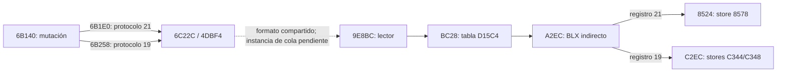

# Persistent Items X/Y: flujo estático y modelo de procedencia

> Registro histórico: la especificación corregida conserva el objeto original
> también tras Lanzamiento, Desarme y Truco. Procedencia y memoria adicional
> no son requisitos del [candidato de dos condiciones](PERSISTENT_ITEMS_GEN6_XY_TWO_GATES.md).
> Hay un candidato X aislado con confirmación del propietario para Baya Zidra;
> producción sigue deshabilitada y falta completar la validación jugable.

27/11/2026. Continuación del PR #145 desde `3ffcafec9af1ea0f3e725efb584795b681574146`.
Se conserva `feature/xy-persistent-items`. **Sin payload, ROM candidata ni
habilitación de producción.** No se solicitaron ni realizaron nuevas batallas.
La evidencia jugable sigue limitada a las capturas originales de X descritas en
[el registro principal](PERSISTENT_ITEMS_GEN6_XY.md); Y no tiene validación jugable.

## Método y límites del grafo

`static_flow.py` exige las identidades completas de `observed_profiles.json`,
incluidas cabeceras reales y dependencias independientes por título. Todos los
offsets de este documento son de archivo CRO; las direcciones de `.code.bin`
se marcan VA. No se usa una base de carga fija.

El grafo parte de 20 regiones declaradas, sin inventar límites mediante búsqueda
de prologues. Sigue instrucciones ARM de cuatro bytes, ramas condicionales y
bucles; resume las llamadas conservando su posible continuación. No supone
que una llamada sea pura ni que un diagnóstico no retorne. Los saltos indirectos
no resueltos permanecen explícitos. Los JSON y listados completos son privados.

Un `LDRLO pc,[pc,index,LSL#2]` solo se expande si el CMP inmediato precedente es
incondicional, está dentro de la región, compara el mismo registro y limita
entre 1 y 256 entradas. Todas las entradas requieren relocación interna ABS32
a código alineado. Un segundo predecesor que eluda el CMP anula esa expansión;
se retiran sus aristas y nodos derivados. Se rechazan presupuestos agotados,
palabras alcanzadas indecodificables y destinos de relocación fuera del segmento.
Se aceptan sentinels de fin de segmento como datos, nunca como destinos ejecutables.

Esto es un CFG acotado y reproducible, **no una prueba global de cobertura**.
Persisten BLX indirectos en `A2EC`, `14148`, `193A8` y retornos mediante carga
de PC cuya pila no se ha modelado (`6C2A8/6C2C0`). Las llamadas a imports,
funciones externas y alias de punteros limitan las conclusiones interprocedurales.

## Escritores directos prioritarios

| Store | Función/región | Destino y datos | Salida |
| --- | --- | --- | --- |
| `8578` | `8524–8580` | Halfword de `params+4` a `Q+0x12` | Devuelve 1. No toca `Q+0x14` en esta función. |
| `C344` | `C2EC–C350` | Halfword de `params+4` a `Q+0x14` | Continúa en `C348`. |
| `C348` | `C2EC–C350` | Cero a `Q+0x12` | Devuelve 1. |

En ambos casos, `E=r0`, `params=r2`, `B=*(E+8)`, `i=*(params)&0xFF` y
`Q=*(B+0x84+4*i)`. El código compara `i` con 24 e invoca el import de diagnóstico
`394` si no es menor. También invoca ese import si el puntero es nulo. No se
ha probado que ese import no retorne: un hook propio deberá validar sus entradas
por sí mismo. Las funciones no consultan parámetro 17 ni acreditan consumibilidad.

No hay BL directos encontrados a `8524/C2EC` en el segmento observado. Sí hay
relocaciones internas verificadas:

| Callback | Slot del puntero | Registro de relocación | Registro de tabla / ID |
| --- | --- | --- | --- |
| `8524` | `D188C` | `EC96C`, tipo 2, segmento 0, addend `83A4` | `D1888`, ID `0x21` |
| `C2EC` | `D182C` | `ECB88`, tipo 2, segmento 0, addend `C16C` | `D1828`, ID `0x19` |

La tabla empieza en `D15C4`, con 109 registros de 12 bytes: ID y descriptor de
callback de dos words. En estos dos registros el ajuste del descriptor vale cero.
`BC28` busca el ID y devuelve ese descriptor. `A298` llama a la búsqueda;
`A29C–A2E8` prepara la llamada, y `A2EC` ejecuta `BLX r3`. Los destinos anteriores
son posibles cuando se seleccionan esos registros, no todos los destinos de ese
BLX. La función conserva también una vía de descriptor virtual no resuelta.

### Relación con el protocolo emitido por `6B140`

`6B1E0` llama a `6C22C` con ID `0x21`, participante en `r2` y nuevo objeto en
`r3`, antes del store principal `6B1EC`. En la ruta `r3_original != 0`,
`6B258` emite ID `0x19`, participante y objeto anterior, después de los stores
`6B240/6B244`.

Los literales relocados `6C2C4` (emisor) y `9EB70` (lector) apuntan a la misma
tabla de formatos, `D13FC`. Ambas entradas `0x19/0x21` valen `0x12`: dos
argumentos, codificados como byte de participante y halfword de objeto.
`6C22C → 4DBF4` serializa; `62078` escribe el ID/halfword en orden big endian;
`9E8BC → 4E808` lee el ID y `9EDD8` empieza a decodificar ese formato. Los
campos resultantes concuerdan con los leídos por los dos callbacks.



Se acredita el vínculo estático de protocolo, no que cada callback sea siempre
un duplicado inocuo. Faltan la identidad de las instancias de cola/tabla y todos
sus emisores. No se puede omitir estos stores del control de procedencia ni
contarlos automáticamente como una segunda pérdida independiente.

## Los cinco callers de la mutación

El switch de `19600` compara el byte bajo del comando con `0x3F` en `196B0` y
despacha mediante 63 entradas relocadas desde `196BC`. El CFG obtiene:

| Call a `6B140` | Contexto | Camino del switch / argumentos |
| --- | --- | --- |
| `1A470` | Región `19600`, bloque `1A3DC` | Caso de script `0x24`; nuevo objeto 0, recordar 1. Lanzamiento observado en captura 08. |
| `1F4EC` | Función `1F36C`, llamada desde `1A304` | Caso `0x21`; destino de `params+6`, nuevo objeto de halfword `params+4`, recordar 0. |
| `20E68` | Función `20C9C`, llamada desde `1A4A8` | Caso `0x25`; uno de dos participantes, valor guardado en pila, recordar 0. |
| `20E7C` | Misma función | Segundo participante, valor conservado en `r9`, recordar 0. |
| `6C1EC` | Función `6C06C` | Llamadas desde `19948/19AD0`, casos `0/9`; tras evento de activación y parámetro 17 no nulo, nuevo objeto 0, recordar 1. Baya propia observada en 07. |

**Los IDs del switch de script y los del protocolo anterior son espacios
distintos**, aunque compartan números. No se equipara `0x21` de un dispatcher
con `0x21` del otro ni se asignan automáticamente movimientos a esos números.

`1F36C` también puede borrar `+0x14` mediante `1F4C8` y, según bytes de sus
parámetros, borrar ese campo de otro participante en `1F5D4`. Tiene eventos de
pre/post cambio y condiciones de veto antes de llegar a la mutación. `20C9C`
obtiene dos punteros de la tabla `+0x84`, guarda sus objetos y hace dos llamadas
con recordar 0; esto acredita una ruta de intercambio de valores. No demuestra
todavía que sea exclusivamente Truco, ni identifica Ladrón/Desarme por nombre.

## Inventario ampliado y copias

El inventario lineal reconoce formas STR/STRB/STRH/STRD, índices de registro,
pre/post indexación, writeback, stores múltiples STM/PUSH y formas de escritura
vectorial/atómica reconocibles por Capstone. Informa operandos y modalidad sin
darles un tipo semántico. Encuentra 21.280 encodings candidatos en el segmento;
incluyen pila y potenciales datos literales. Ese total no mide cobertura útil.

Hay 33 referencias B/BL candidatas a helpers de copia/limpieza: 22 a `42C`,
11 a `414`. En X, los slots de import `430/418` resuelven a VA
`300EF8/15E914`: el primero tiene bucles de lectura/escritura desde `r1` hacia
`r0` con longitud `r2`; el segundo escribe ceros. El informe resuelve los imports
por separado en cada título, sin extrapolar sus ejecutables. Los bucles locales
con LDM/STM y los tamaños obtenidos de registros siguen requiriendo alias/extent.

Casos que evitan una clasificación errónea:

- `13D4C/13D50` usan `r0=*(context+0x10)+0x138`: limpian metadata de resultados,
  no el bloque de un Pokémon.
- `15EC4/15F90/15FE8` también escriben esa metadata; compartir desplazamiento
  no los convierte en cambios de objeto equipado.
- `763D4` construye un participante: asocia el CoreParam en `76408`, obtiene
  su objeto por el import `6AC`, lo escribe en `76434` y limpia `+0x14` en
  `76440`. La inicialización no es un evento de consumo.
- Copias de campos en la región `2ACAC/2AD08` usan offsets y longitudes distintos;
  no se declara que copien el objeto solo porque trabajen con participantes.

## Snapshot original y almacenamiento propuesto

### Punto del ciclo de vida

`13B64` procesa una fase de setup. Entra por `13BAC` cuando su estado vale cero;
`13D0C/13D20` inicializan dos contenedores mediante `6DE9C`, que limpia las
24 celdas de punteros `+0x84`. Los estados posteriores crean/listan participantes
y seleccionan callbacks. **`13BAC` es el candidato estático más temprano de
esta fase**, antes de construir esos contenedores, para copiar la identidad y
el objeto del equipo original desde metadata válida.

No se acredita aún como punto universal de admisión: falta demostrar que todo
combate permitido entra exactamente una vez en esa fase antes de las acciones,
resolver el dueño de `metadata+0x4C` para cada contexto y cubrir reentradas/abortos.
La captura no debe reutilizar la vista mutable de `1945C` como snapshot inicial.
Los constructores `763D4/6D974` sirven para asociar alias posteriores, **no para
reemplazar el snapshot**. `763D4` tiene seis BL directos encontrados; `6D974`
tiene diez, incluidas rutas de refresco, por lo que no implica por sí solo
"primer comienzo de combate".

Identidad: EC/PID/OT-ID más correlación de CoreParam y slot para detectar copias
ambiguas. **OT-ID no es el propietario actual del objeto**: el propietario inicial
se define por pertenencia al equipo persistente al entrar en combate. Un Pokémon
intercambiado puede pertenecer al jugador aunque tenga otro OT-ID.

### Estado propio, sin ocupar padding

Diseño orientativo: header de 64 bytes y seis registros de 64 bytes, total
`0x1C0`, alineado a 8. Solo representan los seis portadores restaurables del
equipo propio. Los demás participantes se tratan como destinos externos; una
transferencia invalida el registro de origen y cualquier registro propio de
destino. La tabla nativa de 24 celdas no equivale a 24 Pokémon restaurables.
Sobrepasar capacidades, no poder identificar un dueño o detectar clones ambiguos
deshabilita la restauración de esa batalla.

| Estado | Contenido necesario |
| --- | --- |
| Header | Magic/versión, epoch de batalla, contexto y equipo dueño, modo acreditado, fase PRE/ACTIVE/FINAL/CLOSED, secuencia y fallo global. |
| Registro | Identidad original, dueño/slot, CoreParam y alias actuales, objeto inicial/observado, evento admitido, bit de invalidación persistente, razón y última secuencia. |

Inicialización solo desde PRE validado. Ningún consumo borra una invalidación.
Un cambio no correlacionable puede invalidar globalmente. Cierre normal: primero
la conciliación original, después una propuesta solo ante objeto final cero e
identidad/propiedad intactas. Retirada y debilitamiento conservan el registro,
sin recrearlo. Huida/derrota/cancelación desconocidas fallan de forma cerrada.
Nunca se escribe en Bolsa ni se sustituye un objeto final nativo no nulo.

Un heap propio es una alternativa a estudiar: el stub `1F4` resuelve en X a
VA `122920` y recibe tamaño/heap; consulta una propiedad virtual del heap antes
de delegar. **No basta con reservar un bloque**: falta acreditar cómo localizar
su puntero sin ocupar campos ajenos y garantizar liberación en todos los cierres.
Otra alternativa es un segmento BSS propio con tamaño/rebase/alloc del cargador
acreditados. No se usa BSS o padding existente por apariencia.

`14218` es una fase candidata de limpieza: espera callbacks y libera recursos,
incluido `context+0x820`, antes de retornar 1. `19308` y el retorno `19460`
no sustituyen una prueba de todos los cierres. Hace falta acreditar cierre de
epoch y liberación incluso ante un aborto que omita conciliación. Ante cierre
forzado del proceso no se debe persistir ninguna restauración pendiente.

ABI del hook futuro: conservar registros vivos y flags, LR y SP; SP alineado
a 8 en llamadas; considerar VFP si se atraviesan funciones que lo usan. Los
offsets se convertirían con la sección realmente cargada. No se han elegido
trampolines, espacio de código, cambios de segmentos ni relocaciones nuevas.

## Modelo de referencia y pruebas

`provenance_model.py` es puro y usa dataclasses inmutables. Exige snapshot PRE
y secuencias completas contiguas. El evento semánticamente acreditado es una
entrada explícita del modelo; **ningún caller nativo lo genera automáticamente**.
`caller`, parámetro 17, `+0x14` y `r3=1` no conceden permiso universal.

Las diez situaciones solicitadas están cubiertas: consumo propio, Lanzamiento,
robo/transferencia, Desarme, cambio posterior, dos consumidores independientes,
objeto final distinto, modo desconocido, identidad ambigua y secuencia incompleta.
La invalidación es permanente por portador; transferencias invalidan ambos extremos
propios; un resultado nativo no cero prevalece. Toda propuesta es solo lógica:
`installable`, `production_enabled` y `payload_present` permanecen falsos.

Resultado: **118 tests Python OK**, incluidos 16 del modelo y 15 del nuevo CFG.
Cinco mutaciones controladas del modelo y cuatro del análisis estático produjeron
fallos de assertions; los tests pasan con las barreras presentes. No representan
ejecuciones de commits antiguos. Evidencias/hashes quedan fuera de Git.

| Caso del modelo | Prueba |
| --- | --- |
| Consumo propio | `test_admitted_original_consumption_can_only_propose_a_disabled_logical_restore` |
| Lanzamiento | `test_fling_knockoff_unknown_write_are_sticky_before_or_after_own_consumption` |
| Robo/transferencia | `test_transfer_and_theft_invalidate_both_endpoints_but_not_an_independent_pokemon` |
| Desarme | `test_fling_knockoff_unknown_write_are_sticky_before_or_after_own_consumption` |
| Cambio posterior | `test_duplicate_consumption_and_destinationless_transfer_remain_excluded` y el control de escritura desconocida posterior anterior |
| Dos consumidores | `test_two_independent_pokemon_can_receive_independent_logical_proposals` |
| Objeto final distinto | `test_final_nonzero_native_item_is_never_overwritten_even_after_admitted_consumption` |
| Modo desconocido | `test_x_and_y_policies_are_independent_and_wild_unknown_modes_have_no_proposal` |
| Identidad ambigua | `test_no_post_or_mutable_snapshot_and_ambiguous_identity_or_slot_never_authorize` |
| Secuencia incompleta | `test_incomplete_noncontiguous_unknown_events_or_missing_native_reconciliation_reject_globally` |

### Ejecución ARM aislada de las funciones originales

`replay_direct_callbacks.py` verificó por separado X e Y y ejecutó las funciones
originales `8524/C2EC` con Unicorn 2.1.4 sobre RAM sintética. Por título: seis
casos válidos (índices 0/23 y truncado a halfword) retornaron 1 con los stores
esperados y conservaron SP/r4–r11. Cuatro controles (índice 24 o puntero nulo)
alcanzaron el diagnóstico `394`, donde el harness se detuvo **antes de ejecutarlo**,
sin stores en esos campos. Esto no demuestra que el diagnóstico real no retorne.
Las funciones elegidas no necesitan relocaciones para sus stores locales: las
ramas relativas se ejecutan con el mismo delta, los punteros de argumentos son
sintéticos y el import diagnóstico se intercepta antes de su stub. El experimento
no certifica el cargador ni que un CRO alterado pueda reubicarse correctamente.

No se ejecutó un combate, no se conectó a Citra ni se modificaron archivos del
juego. Esta prueba verifica instrucciones y condiciones locales, no propietarios
reales, instancias de cola, consumo restaurable ni compatibilidad jugable.

## Viabilidad y diagnóstico

La evidencia permite diseñar los puntos de observación y un modelo reversible,
pero **no permite emitir un payload seguro todavía**:

1. Faltan alias y origen de todos los escritores/copias que pueden afectar al
   portador; los mensajes de protocolo podrían representar sincronización y no
   nuevos eventos, lo que exige evitar tanto omisiones como doble contabilización.
2. El candidato PRE no tiene prueba global de orden, dueño y unicidad del epoch.
3. No hay almacenamiento propio con localización y limpieza acreditadas.
4. Solo se observaron modo salvaje 0 y Liga 1 en X. No se acreditan exclusiones
   Maison/PvP ni se deduce que todo modo 1 sea admisible.
5. La política HLE de Citra estudiada no verifica CRR; una ejecución en ese
   entorno no valida firma de consola ni el binario Lime3DS del propietario.

Alternativas técnicas siguientes, sin requerir ahora combates manuales: ampliar
el análisis de alias de los contenedores y del transporte, resolver el scheduler
de fases desde sus exports/imports, o instrumentar una compilación propia del
emulador con watchpoints de escritura y epochs de contexto. Esta última requiere
fuente/binario reproducibles y recoge cobertura, no sustituye el modelo. Un
prototipo acotado solo podría emitirse cuando el hook, almacenamiento y cobertura
tengan un contrato cerrado; hasta entonces invertir los saltos finales sigue
descartado. No hay cambios de CRO/CRR ni bytes que desinstalar.

## X e Y, reproducción y CI

Ambos conjuntos se verificaron contra sus cabeceras/perfiles independientes. Los
20 grafos y tabla de callbacks coinciden al analizar por separado el mismo
`DllBattle.cro` observado; sus dependencias siguen siendo distintas. La ejecución
ARM aislada pasó en cada título. **Y sigue sin traza de combate**, sin extrapolar
la evidencia 07/08 ni conceder compatibilidad de producción a ninguno.

```powershell
python -m venv artifacts/persistent-research/static-phase-venv
& artifacts/persistent-research/static-phase-venv/Scripts/python.exe -m pip install --only-binary=:all: -r tools/research/xy-persistent-items/requirements-static.txt
& artifacts/persistent-research/static-phase-venv/Scripts/python.exe -m unittest discover -s tools/research/xy-persistent-items -p 'test_*.py' -v
# Informes privados; PROJECT_X/PROJECT_Y son extracciones autorizadas.
& artifacts/persistent-research/static-phase-venv/Scripts/python.exe tools/research/xy-persistent-items/static_flow.py PROJECT_X
& artifacts/persistent-research/static-phase-venv/Scripts/python.exe tools/research/xy-persistent-items/static_flow.py PROJECT_Y
# Solo para replay ARM aislado (no requerido por CI ni por el modelo).
& artifacts/persistent-research/static-phase-venv/Scripts/python.exe -m pip install --only-binary=:all: -r tools/research/xy-persistent-items/requirements-replay.txt
& artifacts/persistent-research/static-phase-venv/Scripts/python.exe tools/research/xy-persistent-items/replay_direct_callbacks.py PROJECT_X
& artifacts/persistent-research/static-phase-venv/Scripts/python.exe tools/research/xy-persistent-items/replay_direct_callbacks.py PROJECT_Y
```

El entorno aislado de CI instala Capstone 5.0.7 y ejecuta el mismo runner Python;
no necesita ROMs, Unicorn, guardados ni entradas privadas. Localmente se creó ese
venv, se instaló el wheel fijado y pasaron las 118 pruebas. Sin cambios C#/WPF,
USUM, recordador, mentas, Level Caps, main o Preview. El CI del commit de referencia
`3ffcafec` terminó en éxito; los commits nuevos requieren su ejecución propia.
